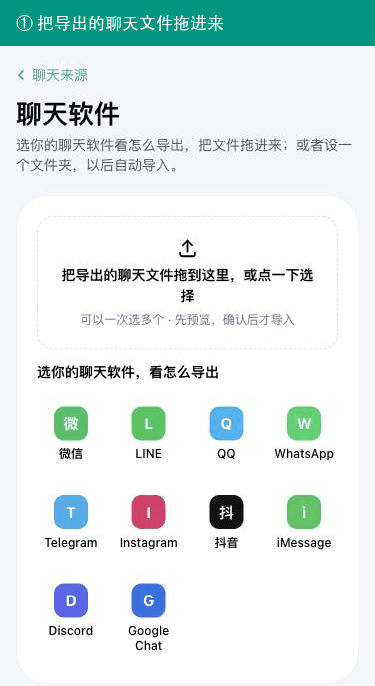

# Personal Radar

**Turn your chat history into a memory of the people you care about** — what you promised, what they told you, plans that changed, and what is coming up this week. Local-first: your chats stay on your own computer.

[中文](README.md) · AGPL-3.0 · early preview, UI in Chinese for now



*The recording uses a fictional chat.*

## What it does

- **Reminders from your chats.** "Saturday 7 pm at the ramen place", "I'll bring the book back", "my interview is next Friday" — found in the conversation, dated, and shown on the day they matter. If a plan changes later, the old one is replaced.
- **A sourced profile of each person.** Likes, dislikes, work, family, things they asked of you. Every line links back to the exact messages it came from, so you can check it.
- **Chat numbers at a glance.** Reply rate, how fast they answer, who writes more, how the conversation's pace changed over time — straight from the messages, right after import. No "interest score": Radar only shows facts.
- **Ask about someone.** "What did she say about her new job?" — answered from your own notes and the original messages, with citations. Five assistants: general, relationship, reply drafts, memory lookup, views.

Nothing is decided for you: anything the AI writes is marked "to check" until you accept it, and it never sends messages to anyone.

## How it works

```
chat export ──drag into Settings → Import──▶ local SQLite (~/.personal-radar)
                                                   │
          Settings → Organize ◀────────────────────┘  your own AI key, redacted before sending
                  │
                  ▼
        reminders + profiles ──▶ web app on localhost (phone: add to home screen)
```

| Supported exports | |
|---|---|
| WeChat — a standard chat JSON or Markdown / text log (WeChat has no official export; getting one is up to you) | QQ — old QQ `.txt` export, common QQ export JSON |
| LINE `.txt` (Japanese, Chinese, English UI) | WhatsApp `.txt` or `.zip` (iPhone and Android) |
| Telegram Desktop `result.json` (one chat or the whole account) | Discord (JSON export) |
| Instagram / Messenger `message_N.json` | Google Chat (Google Takeout `.zip`) |
| Markdown / plain-text chat logs (any exporter; time + sender per message), also zipped | Standard chat JSON / JSONL |

**Automatic import:** watch a folder (point your exporter at it and new files come in by themselves), or connect a hub and sync every few hours. Radar ships no decryption or scraping tools and doesn't recommend any. For apps without an official export (like WeChat), getting your own data out is up to you; Radar reads the standard chat JSON and the Markdown / text logs that many open-source exporters produce.

**Hubs (no export files):** connect [Beeper](https://www.beeper.com) or [ChatLab](https://chatlab.fun) once with a token from their local API, pick chats, and Radar keeps them in sync (read-only). *Not yet tested against the real apps — reports welcome.*

Radar ships no decryption or scraping tools. See the [export guide](docs/export-guide.md) for each app.

## Install

One command (Node.js 22.13+):

```bash
npx github:Ikarishinji00/personal-radar
```

It opens http://localhost:3210 with three fictional demo scenarios (partner & friends, work, night-club hosting). Import a chat and the chat analysis is ready right away, no AI key needed; add your own key when you want reminders.

Other ways:

- **Let your AI assistant do it.** Tell Claude Code, Codex or Cursor: *"Read AGENT_SETUP.md and set up Personal Radar on this computer."* It installs, makes it start at login, and opens the page. ([AGENT_SETUP.md](AGENT_SETUP.md))
- **Docker:** `docker compose up -d`, then open http://localhost:3210. Data goes to `./radar-data`. *(Not yet tested.)*
- **By hand** (Node.js 22.13+):
  ```bash
  git clone https://github.com/Ikarishinji00/personal-radar.git
  cd personal-radar
  npm install
  npm start              # builds once, then opens http://localhost:3210
  ```

The first screen asks whether you want to look at the demo (fictional data) or use your own chats.
Choosing your own chats starts four steps — no config files:

1. **Import:** drag in your exports, check the preview (who is you, how many messages), confirm.
2. **AI service** (or your own agent: Claude Code, Codex and similar can import, organize and run on a schedule without an API key — see [agent/SKILL.md](agent/SKILL.md)): pick DeepSeek, OpenAI, Gemini, OpenRouter, Kimi, Qwen, GLM, a local Ollama model, or any OpenAI-compatible endpoint; paste a key; *Test & save*.
3. **Privacy:** choose what is hidden before sending (keys, emails, phone numbers, card and ID numbers, links), add blocked keywords, or exclude a person entirely. *Try it* shows the result live.
4. **Organize:** see exactly what the first chunk would send, then start. Turn on the daily run if you like.

Prefer the terminal? `npm run import -- <files…>` and `npm run organize` do the same; settings can also come from `.env.local` (see `.env.example`). `examples/` has small fictional exports to try.

Something not working? See [troubleshooting](docs/troubleshooting.md).

### Phone access (optional)

The server only listens on your computer. To use it from your phone, put both devices on a private network you control (for example Tailscale) and add the page to your home screen. Push notifications need HTTPS and `RADAR_PUSH_SUBJECT` set to a `mailto:` address.

## Privacy

- Chats, notes and keys stay in `~/.personal-radar` (override with `RADAR_DATA_DIR`). The original chat files are never modified.
- The server listens on 127.0.0.1 only. It also ignores requests other websites make through your browser: only localhost, 127.0.0.1 and Tailscale host names are answered (against DNS rebinding), and API calls must come from Radar's own pages (against CSRF). Other host names can be added with `RADAR_ALLOWED_HOSTS`.
- Only two things send content to the AI service you chose: organizing (chunks of new messages) and questions you ask in the app. Both pass through the same redaction rules and keyword blacklist at the last step, and both have a preview that shows exactly what would be sent.
- People you mark "不发给 AI" are never organized, analyzed, summarized or included in answers.
- With a local Ollama model nothing leaves your computer.
- Settings → Data: export everything Radar wrote as JSON, or delete everything (cannot be undone).
- Group chats are imported for reading but not organized.

## Compared with

| | Personal Radar | [Monica](https://github.com/monicahq/monica) | [PingCRM](https://github.com/sneg55/pingcrm) |
|---|---|---|---|
| Main job | Reminders and per-person memory from your chats | Personal CRM you fill in by hand | Networking CRM synced from your accounts |
| Gets chats from | Export files, or hubs like Beeper locally | — | Logs into Gmail, Telegram, WhatsApp… |
| AI extracts promises & plans with dates | ✅ with sources | — | Life events, follow-ups |
| Phone + push reminders | ✅ (home-screen web app) | Email reminders | Web app |
| AI provider | Your own key, any OpenAI-compatible, or local Ollama | — | Anthropic |
| Runs | On your computer | Self-host or paid cloud | Self-host or cloud |

Radar reads exports instead of logging into your messaging accounts: less automatic, but no account-ban risk and nothing to hand over.

## Contributing

New importers (KakaoTalk, Signal, iMessage…) and fixes for real-world export variants are the most useful contributions; each format has fixtures and tests in `tests/`. Please read [CONTRIBUTING.md](CONTRIBUTING.md) and the [CLA](CLA.md) first, and never put real chat logs in issues.

## Thanks

Thanks to [ChatLab](https://github.com/ChatLab/ChatLab) for its open chat format and local API, which let Radar read chats people already keep there.

## License

Copyright © 2026 Fu Haike. Released under the [GNU AGPL-3.0](LICENSE): you can use, change and share it; if you run a modified version as a service for others, you must publish your changes under the same license.
