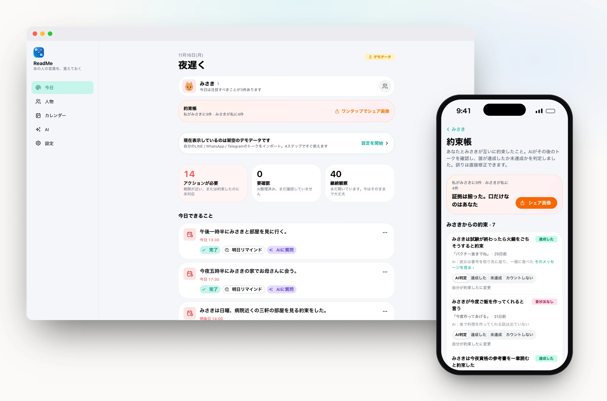
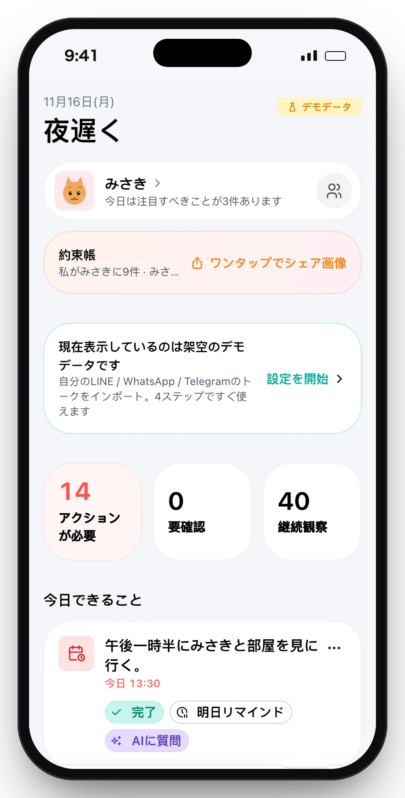
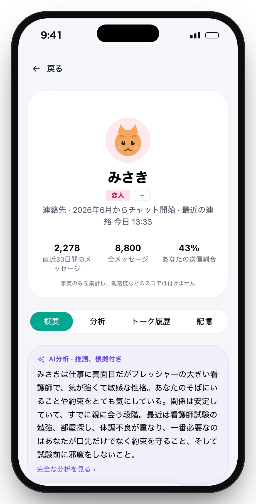
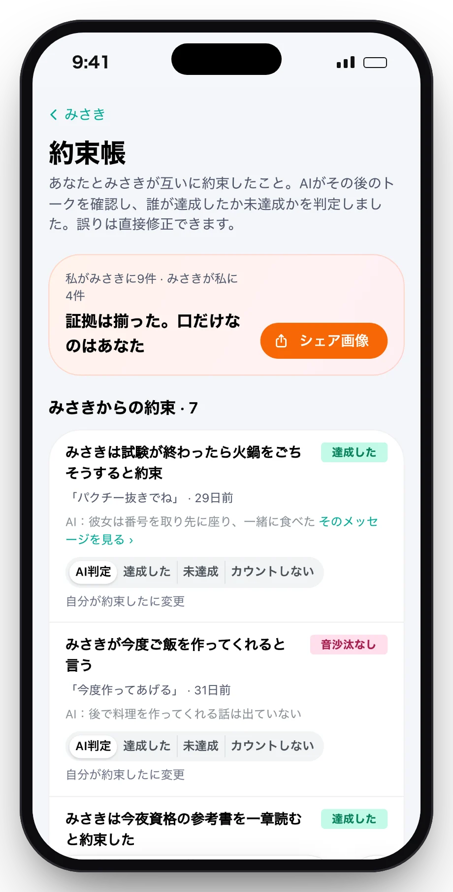
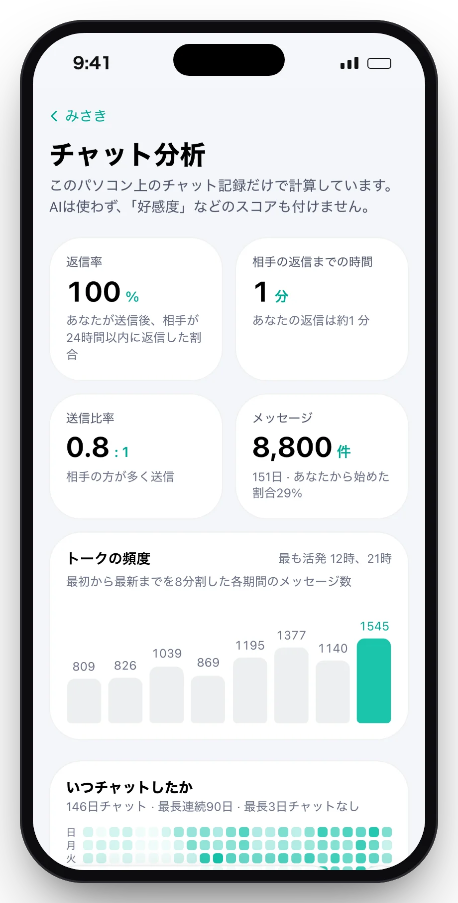
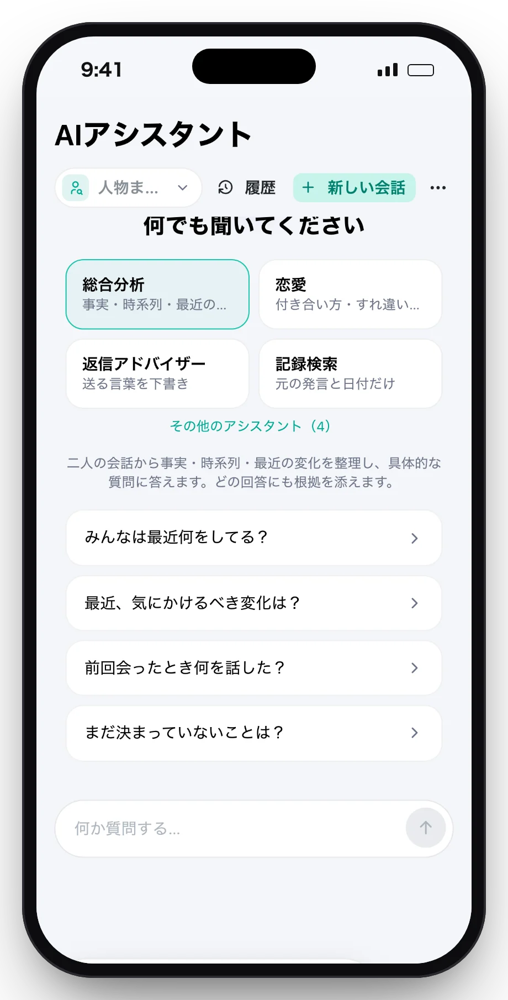
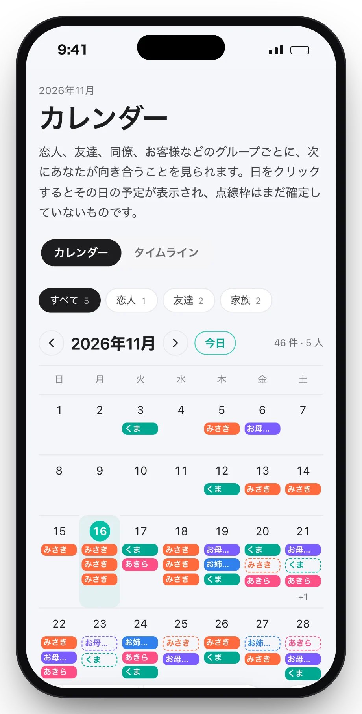

<picture>
  <source media="(prefers-color-scheme: dark)" srcset="docs/assets/banner-ja-dark.webp">
  
</picture>

<p align="center">
  あなたのパソコンで動く「身近な人のメモ帳」。<br>
  ReadMe はトーク履歴から約束や予定、好きなものを見つけて、その日に知らせます。<br>
  どの項目も、元のメッセージに戻って確かめられます。
</p>

<p align="center">
  <a href="https://github.com/Haike0/personal-radar/releases/latest"></a>
  <a href="https://github.com/Haike0/personal-radar/actions/workflows/ci.yml"></a>
  
  <a href="LICENSE"></a>
  <a href="https://github.com/Haike0/personal-radar/stargazers"></a>
</p>

<p align="center">
  <a href="README.md">English</a> ·
  <a href="README.zh-CN.md">简体中文</a> ·
  <b>日本語</b> ·
  <a href="https://haike0.github.io/personal-radar/?lang=ja">公式サイト</a> ·
  <a href="#download">ダウンロード</a> ·
  <a href="docs/troubleshooting.md">ヘルプ</a>
</p>

<p align="center">
  <picture>
    <source media="(prefers-color-scheme: dark)" srcset="docs/assets/hero-ja-dark.webp">
    
  </picture>
</p>

「来月18日に試験だから、その前はあまり誘わないで」と言われた。週末にパソコンを直すと約束した。「明日うちの親に会うなら手ぶらはダメ、父はお茶が好き」とも。全部トークに残っているのに、二日もすれば新しいメッセージに埋もれてしまいます。

ReadMe はトーク履歴を読み、大事なことだけを拾い出します。決めた日にち、約束したこと、変わった予定、その人の好きなものと苦手なもの。それぞれを該当する日に並べ、どの項目もタップすれば元の発言が見られます。すべてあなたのパソコンの中で動きます。

## できること

<table>
  <tr>
    <td width="33%" align="center"><br><b>今日やること</b><br><sub>約束の時間や頼まれごとが、その日のトップに出ます。予定が変われば古いほうは自動で消えます。</sub></td>
    <td width="33%" align="center"><br><b>人物メモ</b><br><sub>好きなもの、苦手なもの、家族、近況。どれも元の発言つき。</sub></td>
    <td width="33%" align="center"><br><b>約束帳</b><br><sub>お互いの約束を洗い出し、守れたかどうかを判定。シェアできるカードもワンタップで。</sub></td>
  </tr>
  <tr>
    <td width="33%" align="center"><br><b>トーク分析</b><br><sub>返信の速さ、どちらが先に話しかけるか、口ぐせ、よく話す時間帯。AIなしで手元で計算。</sub></td>
    <td width="33%" align="center"><br><b>AIに聞く</b><br><sub>「転職の話、なんて言ってた？」あなたのトークだけを根拠に、出典つきで答えます。</sub></td>
    <td width="33%" align="center"><br><b>カレンダー</b><br><sub>恋人・友人・同僚などグループごとに、1か月分の予定をまとめて表示。</sub></td>
  </tr>
</table>

決めるのはあなたです。AI が整理した内容は、あなたが確認するまで「要確認」のまま。ReadMe が誰かにメッセージを送ることはありません。

自分のトークを読み込む前に、架空のデモを3つ試せます。**生活**（恋人・友人・家族）、**仕事**（上司・同僚・取引先）、**夜の接客**（キャストと常連客）。画面は日本語・English・简体中文・繁體中文に対応しています。

<a id="download"></a>
## ダウンロード

| | |
|---|---|
| **macOS**（Apple シリコン） | [ReadMe-mac-arm64.dmg](https://github.com/Haike0/personal-radar/releases/latest/download/ReadMe-mac-arm64.dmg) |
| **macOS**（Intel） | [ReadMe-mac-x64.dmg](https://github.com/Haike0/personal-radar/releases/latest/download/ReadMe-mac-x64.dmg) |
| **Windows** 10 / 11 | [ReadMe-windows-x64.zip](https://github.com/Haike0/personal-radar/releases/latest/download/ReadMe-windows-x64.zip) |
| **Linux**（x64） | [ReadMe-linux-x64.tar.gz](https://github.com/Haike0/personal-radar/releases/latest/download/ReadMe-linux-x64.tar.gz) |

実行環境は同梱しているので、ほかに何もインストールする必要はありません。

- **Mac**：`.dmg` を開き、ReadMe をアプリケーションフォルダへドラッグ。まだ Apple の公証を受けていないため、初回は ReadMe を右クリック →「開く」（macOS 15 以降は「システム設定 → プライバシーとセキュリティ」で「このまま開く」）。以後はメニューバーに常駐し、ブラウザで開きます。
- **Windows**：展開して `ReadMe.cmd` をダブルクリック。SmartScreen が出たら「詳細情報 → 実行」。使っている間は小さなウィンドウを閉じないでください。
- **Linux**：`tar xzf ReadMe-linux-x64.tar.gz && ./ReadMe/readme`

<details>
<summary>開発者向け：Node.js、Docker、AI アシスタントに任せる</summary>

```bash
npx github:Haike0/personal-radar      # Node.js 22.13 以上
```

- **Docker**：`docker compose up -d` のあと http://localhost:3210 を開く（データは `./radar-data`）。
- **ソースから**：`git clone`、`npm install`、`npm start`。
- **エージェントに頼む**：Claude Code・Codex・Cursor に「AGENT_SETUP.md を読んで、このパソコンに ReadMe をセットアップして」と伝えてください。[AGENT_SETUP.md](AGENT_SETUP.md)

</details>

最初の画面でデモを見るか、自分のトークで始めるかを選べます。設定は4ステップで、設定ファイルを書く必要はありません。読み込み → AI サービスの選択 → 隠す情報の選択 → 整理。

## トークの取り込み先

| 自動で同期 | エクスポートから読み込み |
|---|---|
| **iMessage**（Mac、読み取りのみ） | **LINE** `.txt`（日本語・中国語・英語の画面に対応） |
| **WhatsApp** Mac 版（読み取りのみ、実機では未検証） | **WhatsApp** `.txt` / `.zip` |
| **Telegram** 公式 API | **Telegram Desktop** `result.json` |
| **Beeper**（複数アプリを一つのローカル API で、実験的） | **Instagram / Messenger**、**Discord**、**Google Chat** |
| **WeChat**：ほかのツールで復号済みのフォルダ | **QQ** のエクスポート、Markdown / テキスト履歴、汎用トーク JSON |
| エクスポート先に指定したフォルダ | |

ReadMe は読むだけです。トークのアカウントにログインせず、そこから何かを送ることもなく、復号やスクレイピングのツールも一切含みません。各アプリの書き出し方は[エクスポートガイド](docs/export-guide.md)にあります。

## データはあなたのもの

- トーク・整理結果・API キーは、あなたのパソコンの `~/.personal-radar` にだけ保存。アカウントもサーバーもありません。
- ReadMe はこのパソコンからしか開けません。同じ Wi-Fi の人もアクセスできません。
- 外に出るのは、整理するときと質問するときの2回だけ。どちらも送る前に、キー・メール・電話番号・カード番号・身分証番号・リンクをあなたのルールで隠し、送る内容をプレビューできます。
- 特定の人を AI から完全に外せます。Ollama のローカルモデルを使えば、何も外に出ません。
- AI は DeepSeek・OpenAI・Gemini・OpenRouter・Kimi・Qwen・GLM など OpenAI 互換なら何でも。キーなしで、手元の Claude Code や Codex に整理させることもできます。
- 「設定 → データ」から、ReadMe が書いたものをすべて JSON で書き出す、またはすべて削除できます。

## ほかのツールとの比較

| | ReadMe | [Monica](https://github.com/monicahq/monica) | [WeClone](https://github.com/xming521/WeClone) | [PingCRM](https://github.com/sneg55/pingcrm) |
|---|---|---|---|---|
| 主な役割 | トークから約束を知らせ、一人ひとりを覚えておく | 手入力の個人 CRM | 人生のポートレートと AI 分身 | アカウント連携の人脈 CRM |
| 日付つきの約束・予定を抽出 | ✅ 元の発言つき | — | — | フォローアップ |
| 約束帳とシェアカード | ✅ | — | — | — |
| 取り込み先 | 14 種類（うち 5 種類は自動同期） | — | Telegram（＋CSV） | Gmail、Telegram、WhatsApp、X、LinkedIn |
| デスクトップ版 | ✅ macOS · Windows · Linux | セルフホスト | Python | セルフホスト／クラウド |
| 動作場所 | あなたのパソコン | セルフホスト／有料クラウド | あなたのパソコン | セルフホスト／クラウド |

## よくある質問

<details><summary><b>無料ですか？</b></summary>はい。ReadMe はオープンソース（AGPL-3.0）です。有料の AI サービスを使う場合は、使った分をそのサービスに直接支払います。ローカルモデルなら費用はかかりません。</details>
<details><summary><b>LINE のトークを自動で取り込めますか？</b></summary>LINE には公式の自動連携がないため、トークごとの「トーク履歴を送信」で書き出した .txt を読み込みます。iMessage・WhatsApp（Mac）・Telegram は自動で同期できます。</details>
<details><summary><b>スマホで使えますか？</b></summary>使えます。パソコンとスマホを自分専用のネットワーク（Tailscale など）に入れ、ページをホーム画面に追加してください。リマインダーはプッシュ通知や iPhone の Bark アプリでも受け取れます。</details>
<details><summary><b>勝手にメッセージを送ったりしませんか？</b></summary>しません。ReadMe には送信の機能がなく、読む・整理する・知らせるだけです。</details>
<details><summary><b>AI が間違えたら？</b></summary>どの項目も元のメッセージにつながっています。新しく整理された項目は「要確認」のまま待機し、どれでも修正・削除できます。</details>

## ロードマップ

- [x] macOS・Windows・Linux のデスクトップ版
- [x] iMessage・WhatsApp（Mac）・Telegram・Beeper・WeChat フォルダの自動同期
- [x] 約束帳とシェアカード
- [x] 日本語・English・简体中文・繁體中文
- [ ] Apple 公証済みの Mac 版
- [ ] 読み取り専用のオンラインデモ
- [ ] KakaoTalk・Signal の読み込み
- [ ] MCP サーバー（Claude などから「彼女に何を約束した？」と聞ける）
- [ ] 整理精度のベンチマーク

## コントリビュート

いちばん助かるのは、新しい読み込み形式（KakaoTalk、Signal など）と、実際のエクスポートの差異への対応です。形式ごとに `tests/` にサンプルとテストがあります。先に [CONTRIBUTING.md](CONTRIBUTING.md) と [CLA](CLA.md) をお読みください。Issue に本物のトーク履歴は貼らないでください。

## Star の推移

<a href="https://star-history.com/#Haike0/personal-radar&Date">
  <picture>
    <source media="(prefers-color-scheme: dark)" srcset="https://api.star-history.com/svg?repos=Haike0/personal-radar&type=Date&theme=dark">
    
  </picture>
</a>

## 謝辞

オープンなトーク形式とローカル API を公開している [ChatLab](https://github.com/ChatLab/ChatLab) に感謝します。

## ライセンス

Copyright © 2026 Fu Haike。[GNU AGPL-3.0](LICENSE) で公開しています。自由に使い、改変し、共有できます。改変版を他の人向けのサービスとして提供する場合は、同じライセンスで変更点を公開してください。
