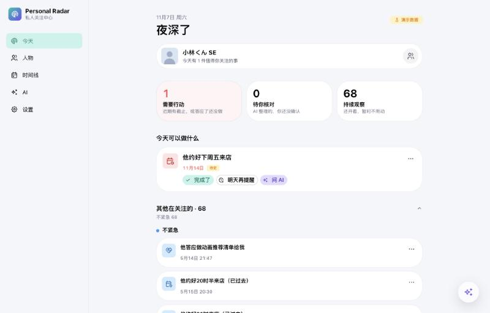
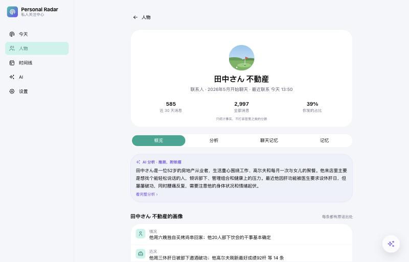

# Personal Radar

**Turn your chat history into a memory of the people you care about** — what you promised, what they told you, plans that changed, and what is coming up this week. Local-first: your chats stay on your own computer.

[中文说明](#中文说明) · AGPL-3.0 · early preview (v0.1), UI in Chinese for now

| Today | A person |
|---|---|
|  |  |

*Screenshots use the built-in fictional demo data.*

## What it does

- **Reminders from your chats.** "Saturday 7 pm at the ramen place", "I'll bring the book back", "my interview is next Friday" — found in the conversation, dated, and shown on the day they matter. If a plan changes later, the old one is replaced.
- **A sourced profile of each person.** Likes, dislikes, work, family, things they asked of you. Every line links back to the exact messages it came from, so you can check it.
- **Ask about someone.** "What did she say about her new job?" — answered from your own notes and the original messages, with citations.

Nothing is decided for you: anything the AI writes is marked "to check" until you accept it, and it never sends messages to anyone.

## How it works

```
chat export (.txt / .json) ──npm run import──▶ local SQLite (~/.personal-radar)
                                                    │
                          npm run organize ◀────────┘  your own API key (DeepSeek by default)
                                │
                                ▼
                      reminders + profiles ──▶ web app on localhost (phone: add to home screen)
```

- **Import** reads LINE and WhatsApp text exports and ChatLab JSON. Re-importing a newer export only adds new messages.
- **Organize** sends the new messages, in small chunks, to an OpenAI-compatible API you choose, and stores the results with message IDs (not copies of the text). It shows you which chats it will send and asks first.
- **The app** is a Next.js PWA that listens on `localhost` only.

## Quick start

Requires **Node.js 22.13 or newer** (for the built-in `node:sqlite`).

```bash
git clone https://github.com/Ikarishinji00/personal-radar.git
cd personal-radar
npm install
npm run dev            # http://localhost:3210 — opens with fictional demo data
```

Use your own chats:

```bash
cp .env.example .env.local        # put your API key in RADAR_AI_KEY
npm run import -- "WhatsApp Chat with Alex.txt"
npm run organize
```

Then open **设置 (Settings) → 数据 → 真实** to switch from demo data to your own.

Try it without real data first: `examples/` has small fictional exports in all three formats.

### Exporting a chat

- **WhatsApp:** open the chat → contact name → *Export Chat* → *Without Media*. Unzip and import the `.txt`.
- **LINE:** open the chat → menu (≡) → *Settings / その他* → *Export chat history / トーク履歴を送信*. Import the `.txt`. (Menu names differ a little between LINE versions.)
- **ChatLab JSON:** any file in ChatLab's JSON format (`meta` + `members` + `messages`). If you already use [ChatLab](https://chatlab.fun), you can instead set `CHATLAB_DATA_DIR=~/.chatlab/data` and Radar will read its databases (read-only).

If the importer can't tell which participant is you, pass `--me "your name"`. WhatsApp dates are auto-detected; force with `--date-order dmy` or `mdy`.

### Running it every day

```bash
# crontab -e   (21:50 every day; --yes skips the confirmation)
50 21 * * * cd /path/to/personal-radar && /path/to/node scripts/organize.mjs --yes
```

### Phone access (optional)

The server only listens on your computer. To use it from your phone, put both devices on a private network you control (for example Tailscale) and add the page to your home screen. Push notifications need HTTPS and `RADAR_PUSH_SUBJECT` set to a `mailto:` address.

## Privacy

- Chats, notes and keys stay in `~/.personal-radar` (override with `RADAR_DATA_DIR`). Nothing is uploaded except what `organize` and the in-app Q&A send to the AI provider you configured; in the AI panel, “发送内容预览” shows exactly what a question would send, without sending it.
- The default provider is DeepSeek (servers in China). Any OpenAI-compatible endpoint works: set `RADAR_AI_BASE_URL` and `RADAR_AI_MODEL`.
- Group chats are imported but not organized.

## Contributing

New importers (Telegram, KakaoTalk, Messenger, iMessage…) are the most useful contribution. Please read [CONTRIBUTING.md](CONTRIBUTING.md) and the [CLA](CLA.md) first, and never put real chat logs in issues.

## License

Copyright © 2026 Fu Haike. Released under the [GNU AGPL-3.0](LICENSE): you can use, change and share it; if you run a modified version as a service for others, you must publish your changes under the same license.

---

## 中文说明

**把聊天记录变成你对身边人的记忆**：你答应过的事、对方说过的事、改了的约、这周要到的日子。数据只在你自己的电脑上。

### 能做什么
- **从聊天里找出要记住的事**：约了几点、答应带什么、下周五面试……按日期提醒你；安排变了，旧的会自动作废。
- **每个人的画像**：喜好、忌讳、工作、家人、对你提过的要求，每一条都能点回原话核对。
- **问 AI**：「她换工作的事是怎么说的？」——从你自己的记录和原话里回答，并标出处。

AI 整理出的内容在你确认之前都标着「待核对」；它不会替你给任何人发消息。

### 三步用起来
需要 **Node.js 22.13 以上**。

```bash
npm install
npm run dev                      # 打开 http://localhost:3210，先看演示数据
cp .env.example .env.local       # 填上你自己的 API 密钥（默认 DeepSeek）
npm run import -- 导出的聊天.txt  # LINE / WhatsApp 导出的 .txt，或 ChatLab JSON
npm run organize                 # 用你的密钥整理；发之前会列出要发哪些聊天并让你确认
```

然后在「设置 → 数据」里切到「真实」。

### 隐私
- 聊天、整理结果、密钥都在 `~/.personal-radar`，App 只在本机监听。
- 只有两种时候会把内容发出去：运行 `organize` 时（一段段过滤过的新消息），和你在 App 里提问时（AI 对话框里的「发送内容预览」能看到具体会发什么）。都只发给你自己配置的 AI 服务。
- 默认用 DeepSeek（服务器在中国），可以换成任何兼容 OpenAI 接口的服务。

### 许可
AGPL-3.0。提交代码前请先看 [CLA](CLA.md)。
