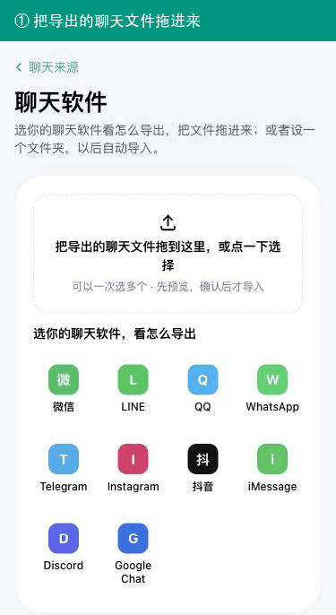

# 别再忘了她说过的话



**聊天不离开你的电脑。** 没有账号，没有云端。整理时只把新消息发给你自己选的 AI，发之前先隐藏手机号、卡号这些；换成本机模型，一条都不出门。

她说下个月 18 号考试，让你考前少找她玩。你答应周末帮她修电脑。她提醒你明天见她爸妈别空手去，她爸爱喝茶。这些话都在聊天里，过两天就被新消息冲没了。

Personal Radar 读你导出的聊天记录，把约好的事、答应过的事、改了的安排找出来，到日子提醒你。每一条都能点回原话核对。

```bash
npx github:Ikarishinji00/personal-radar
```

一条命令，半分钟内浏览器自动打开（需要 [Node.js](https://nodejs.org) 22.13 以上）。先看演示，再导入自己的聊天：导入完马上能看聊天分析，不用填任何密钥；想让它找出约定和承诺时，再填你自己的 AI 密钥。

[English](README.en.md) · AGPL-3.0 · 早期预览版

---

## 三个演示场景

打开后可以先逛编好的演示数据，人和聊天全是虚构的：

- 生活：女朋友、朋友、家人。见家长、看房、她考试的日子、朋友答应还的钱、妈妈的生日。
- 职场：上司、同事、客户。评审提前了、周报几点交、开发答应哪天修好 bug、客户的尾款。
- 夜场接客：常客的喜好、来店和同伴、生日、上次聊到哪。

## 能做什么

- **从聊天里找出要记住的事**：约了几点、答应带什么、下周五面试，按日期提醒你。安排变了，旧的会自动作废。
- **说话算数账本**：AI 翻出你们俩互相答应过的事，看谁做到了、谁没做，首页一键生成能晒的卡片：「我欠她 7 件，她欠我 5 件」。
- **聊天分析，不用 AI**：回复率、谁回得快、谁先开口、口头禅、常用表情、什么时候聊得多，导入后马上算好。不打「好感度」之类的分。
- **每个人的画像**：喜好、忌讳、工作、家人、对你提过的要求，每一条都能点回原话。
- **问 AI**：「她换工作的事是怎么说的？」可以单独选一个人问，也可以按标签（恋人、同事、客户）问一群人。回答只根据你的记录和原话，并标出处。

AI 整理出的内容在你确认之前都标着「待核对」。它不会替你给任何人发消息。

## 能导入哪些聊天

| | |
|---|---|
| LINE `.txt`（日文、中文、英文界面） | WhatsApp `.txt` 或 `.zip`（iPhone 和安卓） |
| Telegram Desktop `result.json` | Instagram / Messenger `message_N.json` |
| Discord JSON 导出 | Google Chat（Google Takeout `.zip`） |
| QQ 旧版 `.txt` 导出、常见的 QQ 导出 JSON | 通用聊天格式 JSON / JSONL |
| 每条带时间和发送人的 Markdown / 文本记录，也可以打包成 zip | |

微信官方不支持导出聊天记录，需要你自己解决（可以参考其他开源项目）。Radar 不带任何解密或抓取工具，能读通用聊天格式和 Markdown / 文本记录。

**自动导入**：设一个文件夹，导出工具存到这里，新文件每 5 分钟自动导入；也可以在「聚合平台」连接 Beeper、ChatLab，每隔几小时同步一次（还没用真实软件测过，欢迎反馈）。

各个 App 怎么导出见 [导出指南](docs/export-guide.md)，遇到问题看 [常见问题](docs/troubleshooting.md)。

## 怎么用起来

打开后点「用我自己的聊天」，四步，全程不用改配置文件：

1. 导入：拖入导出的聊天文件，预览（哪个是你、多少条），确认。导入完马上能看聊天分析。
2. AI 服务：选 DeepSeek、OpenAI、Gemini、OpenRouter、Kimi、通义千问、智谱，或本机 Ollama，或任何兼容 OpenAI 接口的服务；粘贴密钥，点「测试并保存」。已经在用 Claude Code、Codex、WorkBuddy、Hermes 这类 agent 的话，可以不填密钥：复制 App 里给的一句话发给它，它会替你导入新聊天、整理，还能每天定时做（见 [agent/SKILL.md](agent/SKILL.md)）。
3. 隐私：选发出去之前要隐藏什么（密钥、邮箱、电话、卡号、证件号、链接），加屏蔽词，或者让某个人完全不发给 AI。
4. 整理：先看第一段会发出去什么，再开始。可以打开每天自动整理。

其他安装方式：

- 让 AI 助手帮你装：对 Claude Code、Codex 或 Cursor 说「读 AGENT_SETUP.md，在这台电脑上装好 Personal Radar」。见 [AGENT_SETUP.md](AGENT_SETUP.md)。
- Docker：`docker compose up -d`，打开 http://localhost:3210，数据在 `./radar-data`（还没实测）。
- 手动：
  ```bash
  git clone https://github.com/Ikarishinji00/personal-radar.git
  cd personal-radar
  npm install
  npm start
  ```

想在手机上用：两台设备放进你自己的私有网络（比如 Tailscale），把页面加到主屏幕。推送通知需要 HTTPS，并设置 `RADAR_PUSH_SUBJECT`。

## 隐私

- 聊天、整理结果、密钥都在 `~/.personal-radar`（可用 `RADAR_DATA_DIR` 改），原来的导出文件不会被改动。
- App 只在本机监听，同一个 Wi-Fi 里的人连不上。它也不理会别的网站借你的浏览器发来的请求：只接受 localhost、127.0.0.1 和 Tailscale 地址，改动数据的操作必须来自 Radar 自己的页面。
- 只有两种时候会把内容发出去：整理聊天时，和你在 App 里提问时。发出前都按你的规则隐藏敏感信息，屏蔽词所在的消息整条不发；两处都能先预览具体发什么。
- 设成「不发给 AI」的人，不整理、不分析、不出现在回答里。
- 用本机 Ollama 模型则完全不联网。默认的 DeepSeek 服务器在中国，可以换成别的服务。
- 设置 → 数据管理：把 Radar 写下的东西全部导出成 JSON，或者全部删除（不能恢复）。
- 群聊只导入查看，不会被整理。

## 和别的工具比

| | Personal Radar | [Monica](https://github.com/monicahq/monica) | [PingCRM](https://github.com/sneg55/pingcrm) |
|---|---|---|---|
| 主要做什么 | 从聊天里提醒约定、记住每个人 | 手动填写的个人 CRM | 从账号同步的人脉 CRM |
| 聊天从哪来 | 导出文件，或本机的聚合软件 | — | 登录 Gmail、Telegram、WhatsApp… |
| AI 找出带日期的约定和承诺 | ✅ 带原话出处 | — | 人生大事、跟进提醒 |
| 手机推送提醒 | ✅（加到主屏幕的网页） | 邮件提醒 | 网页 |
| AI 服务 | 你自己的密钥，任何兼容 OpenAI 的服务，或本机 Ollama | — | Anthropic |
| 运行在哪 | 你自己的电脑 | 自建或付费云 | 自建或云 |

Radar 读导出文件，不登录你的聊天账号：没那么自动，但没有封号风险，也不用把账号交给谁。

## 参与

最有用的贡献是新的导入格式（KakaoTalk、Signal、iMessage…）和对真实导出变体的修正，每种格式在 `tests/` 里都有样例和测试。提交前请先看 [CONTRIBUTING.md](CONTRIBUTING.md) 和 [CLA](CLA.md)，不要在 issue 里贴真实聊天记录。

## 致谢

感谢 [ChatLab](https://github.com/ChatLab/ChatLab) 开放的聊天格式和本地接口，让 Radar 能读取大家已经存在 ChatLab 里的聊天。

## 许可

Copyright © 2026 Fu Haike。以 [GNU AGPL-3.0](LICENSE) 发布：可以使用、修改、分享；如果把改过的版本作为服务提供给别人，需要用同样的许可公开你的修改。
