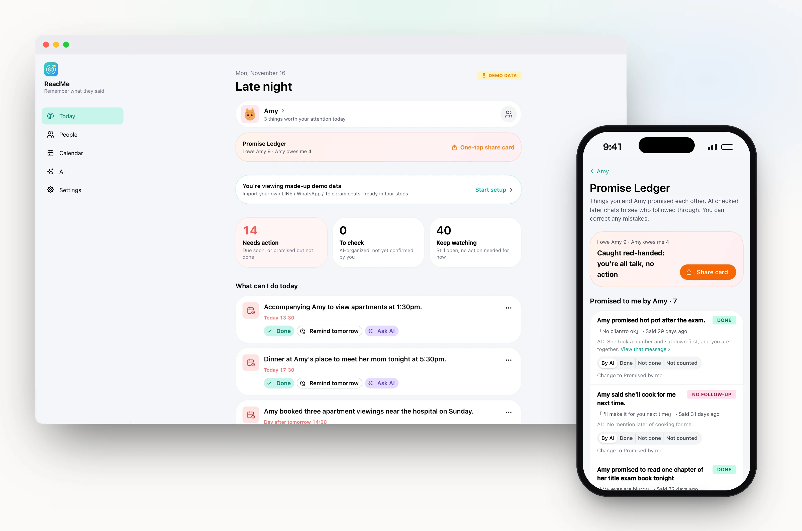
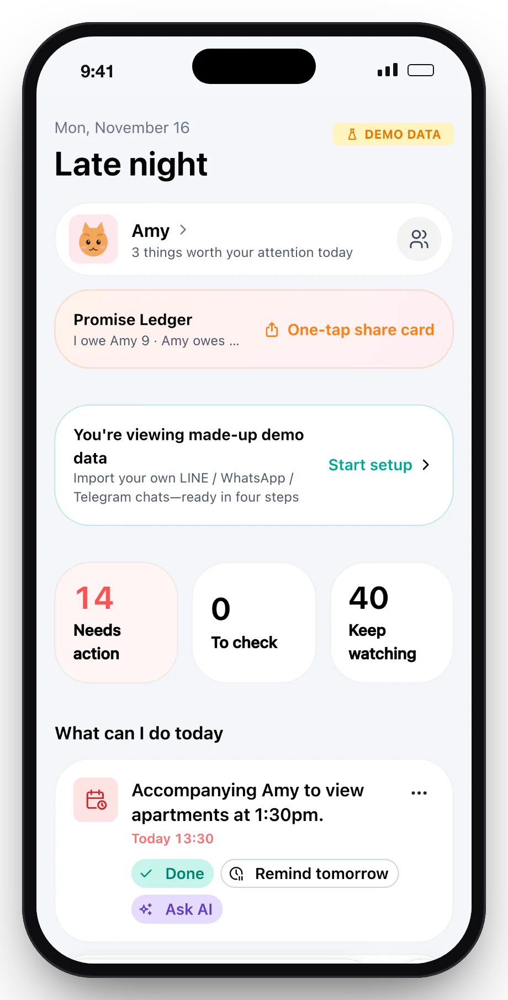
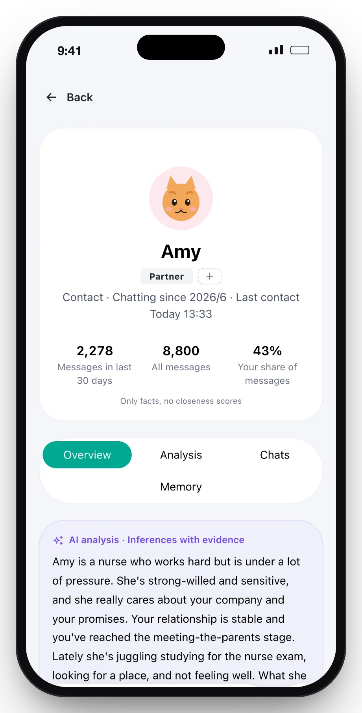
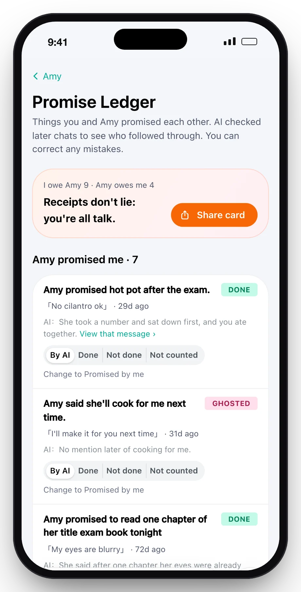
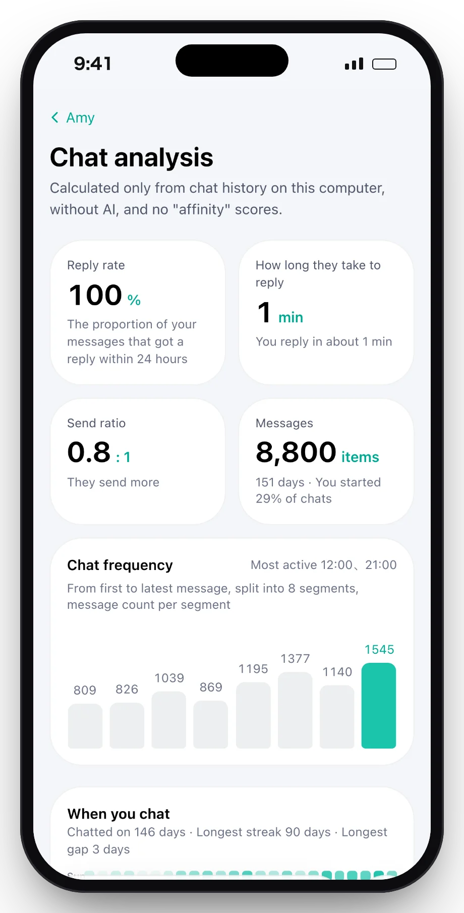
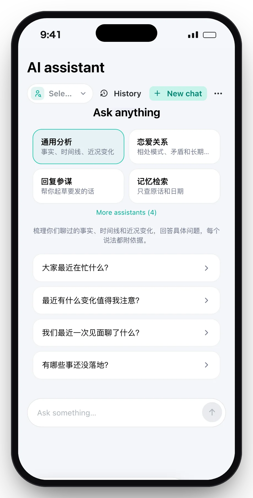
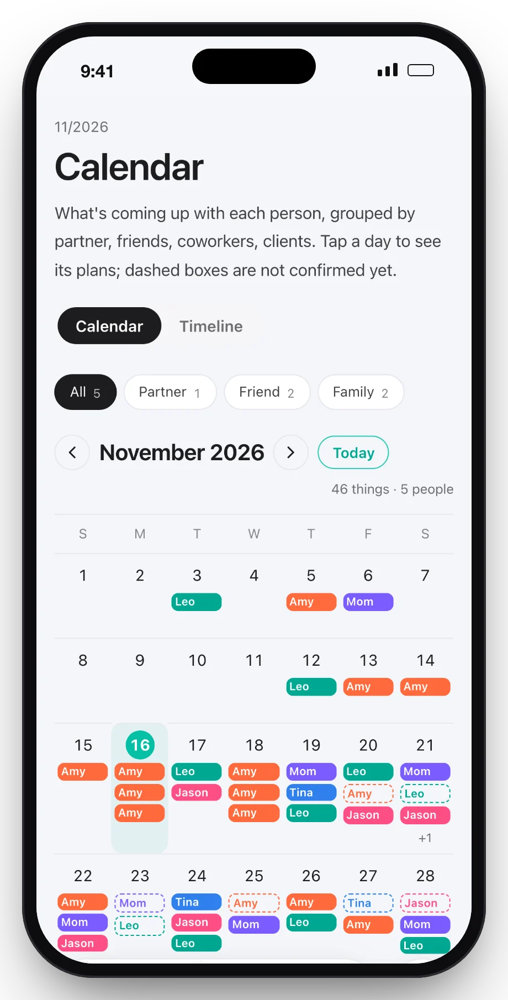

<picture>
  <source media="(prefers-color-scheme: dark)" srcset="docs/assets/banner-en-dark.webp">
  
</picture>

<p align="center">
  Local-first memory for the people in your life.<br>
  ReadMe finds the plans, promises and preferences in your chats and reminds you on the day,<br>
  with every line traced back to the original message.
</p>

<p align="center">
  <a href="https://github.com/Ikarishinji00/personal-radar/releases/latest"></a>
  <a href="https://github.com/Ikarishinji00/personal-radar/actions/workflows/ci.yml"></a>
  
  <a href="LICENSE"></a>
  <a href="https://github.com/Ikarishinji00/personal-radar/stargazers"></a>
</p>

<p align="center">
  <b>English</b> ·
  <a href="README.zh-CN.md">简体中文</a> ·
  <a href="README.ja.md">日本語</a> ·
  <a href="https://ikarishinji00.github.io/personal-radar/">Website</a> ·
  <a href="#download">Download</a> ·
  <a href="docs/troubleshooting.md">Help</a>
</p>

<p align="center">
  <picture>
    <source media="(prefers-color-scheme: dark)" srcset="docs/assets/hero-en-dark.webp">
    
  </picture>
</p>

She mentioned her exam is on the 18th and asked you to give her some space before it. You promised to fix her laptop this weekend. She reminded you that her dad likes tea, so don't show up empty-handed. All of it is in the chat, and two days later it's buried under new messages.

ReadMe reads your chat history and pulls out what matters: dates you agreed on, things you promised, plans that changed, what each person likes and can't stand. It puts them on the right day and lets you tap any line to see the exact words. Everything runs on your own computer.

## What it does

<table>
  <tr>
    <td width="33%" align="center"><br><b>Today</b><br><sub>Plans and promises show up on the day they matter. When a plan changes, the old one is replaced.</sub></td>
    <td width="33%" align="center"><br><b>A profile for everyone</b><br><sub>Likes, dislikes, family, what's new. Every line keeps the words it came from.</sub></td>
    <td width="33%" align="center"><br><b>Promise ledger</b><br><sub>Who promised what, and who actually did it. One tap makes a card you can share.</sub></td>
  </tr>
  <tr>
    <td width="33%" align="center"><br><b>Chat stats</b><br><sub>Who replies faster, who texts first, pet phrases, busiest hours. Computed locally, no AI.</sub></td>
    <td width="33%" align="center"><br><b>Ask</b><br><sub>"What did she say about the new job?" Answers come only from your chats, with sources.</sub></td>
    <td width="33%" align="center"><br><b>Calendar</b><br><sub>A month of everyone's dates, grouped by partner, friends, coworkers and clients.</sub></td>
  </tr>
</table>

Nothing is decided for you. Anything the AI writes is marked "to check" until you accept it, and ReadMe never sends a message to anyone.

The built-in demo has three fictional circles to explore before you import anything: **Life** (partner, friends, family), **Work** (boss, coworkers, clients) and **Nightlife** (a hostess and her regulars). The interface speaks English, 简体中文, 繁體中文 and 日本語.

<a id="download"></a>
## Download

| | |
|---|---|
| **macOS** (Apple Silicon) | [ReadMe-mac-arm64.dmg](https://github.com/Ikarishinji00/personal-radar/releases/latest/download/ReadMe-mac-arm64.dmg) |
| **macOS** (Intel) | [ReadMe-mac-x64.dmg](https://github.com/Ikarishinji00/personal-radar/releases/latest/download/ReadMe-mac-x64.dmg) |
| **Windows** 10 / 11 | [ReadMe-windows-x64.zip](https://github.com/Ikarishinji00/personal-radar/releases/latest/download/ReadMe-windows-x64.zip) |
| **Linux** (x64) | [ReadMe-linux-x64.tar.gz](https://github.com/Ikarishinji00/personal-radar/releases/latest/download/ReadMe-linux-x64.tar.gz) |

Nothing else to install: each download carries its own runtime.

- **Mac**: open the `.dmg` and drag ReadMe into Applications. The app isn't notarized by Apple yet, so the first time, right-click ReadMe → **Open** (on macOS 15 and later: System Settings → Privacy & Security → **Open Anyway**). ReadMe then sits in the menu bar and opens in your browser.
- **Windows**: unzip, double-click `ReadMe.cmd`. If SmartScreen appears, choose **More info → Run anyway**. Keep the small window open while you use ReadMe.
- **Linux**: `tar xzf ReadMe-linux-x64.tar.gz && ./ReadMe/readme`

<details>
<summary>For developers: Node.js, Docker, or let your AI assistant set it up</summary>

```bash
npx github:Ikarishinji00/personal-radar      # Node.js 22.13+
```

- **Docker**: `docker compose up -d`, then open http://localhost:3210 (data goes to `./radar-data`).
- **From source**: `git clone`, `npm install`, `npm start`.
- **Ask your agent**: tell Claude Code, Codex or Cursor *"Read AGENT_SETUP.md and set up ReadMe on this computer."* See [AGENT_SETUP.md](AGENT_SETUP.md).

</details>

The first screen lets you look around the demo or start with your own chats. Setup takes four steps and no config files: import, pick an AI service, choose what to hide, organize.

## Where your chats come from

| Kept in sync automatically | Imported from an export |
|---|---|
| **iMessage** (Mac, read-only) | **LINE** `.txt` (Japanese, Chinese, English UI) |
| **WhatsApp** desktop on Mac (read-only, not yet tested on a real install) | **WhatsApp** `.txt` / `.zip` |
| **Telegram** through the official API | **Telegram Desktop** `result.json` |
| **Beeper** (one local API for many apps, experimental) | **Instagram / Messenger**, **Discord**, **Google Chat** |
| **WeChat** folders you've already decrypted with other tools | **QQ** exports, Markdown / plain-text logs, standard chat JSON |
| A folder you point your exporter at | |

ReadMe only reads. It never logs into your chat accounts, never sends anything through them, and ships no decryption or scraping tools. Step-by-step export instructions for each app are in the [export guide](docs/export-guide.md).

## Your data stays yours

- Chats, notes and keys live in `~/.personal-radar` on your computer. There's no account and no server.
- ReadMe listens on your computer only, so nobody on the same Wi-Fi can open it.
- Content goes out at exactly two moments: when you organize, and when you ask a question. Both pass through your redaction rules first (keys, emails, phone, card and ID numbers, links), and both show a preview of what will be sent.
- Leave anyone out of AI completely. Use a local model through Ollama and nothing leaves your computer at all.
- Bring any OpenAI-compatible service (DeepSeek, OpenAI, Gemini, OpenRouter, Kimi, Qwen, GLM…), or let your own agent (Claude Code, Codex) do the organizing without a key.
- Export everything ReadMe wrote as JSON, or delete it all, from Settings → Data.

## Compared with

| | ReadMe | [Monica](https://github.com/monicahq/monica) | [WeClone](https://github.com/xming521/WeClone) | [PingCRM](https://github.com/sneg55/pingcrm) |
|---|---|---|---|---|
| Main job | Reminders and per-person memory from your chats | Personal CRM you fill in by hand | Life portrait and an AI clone of you | Networking CRM synced from accounts |
| Finds dated plans and promises | ✅ with the original words | — | — | Follow-ups |
| Promise ledger + share card | ✅ | — | — | — |
| Chat sources | 14, five of them synced automatically | — | Telegram (+ CSV) | Gmail, Telegram, WhatsApp, X, LinkedIn |
| Desktop download | ✅ macOS · Windows · Linux | Self-host | Python | Self-host / cloud |
| Runs | On your computer | Self-host or paid cloud | On your computer | Self-host or cloud |

## FAQ

<details><summary><b>Is it free?</b></summary>Yes. ReadMe is open source (AGPL-3.0). If you use a paid AI service, you pay that service directly for what you use; a local model costs nothing.</details>
<details><summary><b>Does it work with WeChat?</b></summary>WeChat has no official export. If you have already decrypted your WeChat database with other tools, choose that folder in Settings → Chat sources and ReadMe keeps it in sync, read-only. ReadMe itself doesn't decrypt anything.</details>
<details><summary><b>Can I use it on my phone?</b></summary>Yes. Put your computer and phone on a private network you control (for example Tailscale) and add the page to your home screen. Reminders can arrive as push notifications, or through the Bark app on iPhone.</details>
<details><summary><b>Will it ever message someone for me?</b></summary>No. ReadMe has no way to send messages. It reads, organizes and reminds.</details>
<details><summary><b>What if the AI gets something wrong?</b></summary>Every item links to the messages it came from. Anything new is marked "to check" until you accept it, and you can correct or delete any line.</details>

## Roadmap

- [x] Desktop downloads for macOS, Windows and Linux
- [x] Automatic sync for iMessage, WhatsApp (Mac), Telegram, Beeper, WeChat folders
- [x] Promise ledger and share card
- [x] English, 简体中文, 繁體中文, 日本語
- [ ] Notarized Mac app
- [ ] Read-only online demo
- [ ] KakaoTalk and Signal importers
- [ ] MCP server, so Claude and other assistants can ask "what did I promise her?"
- [ ] An accuracy benchmark for the organizing step

## Contributing

The most useful contributions are new importers (KakaoTalk, Signal…) and fixes for real-world export variants; each format has fixtures and tests in `tests/`. Please read [CONTRIBUTING.md](CONTRIBUTING.md) and the [CLA](CLA.md) first, and never put real chat logs in issues.

## Star history

<a href="https://star-history.com/#Ikarishinji00/personal-radar&Date">
  <picture>
    <source media="(prefers-color-scheme: dark)" srcset="https://api.star-history.com/svg?repos=Ikarishinji00/personal-radar&type=Date&theme=dark">
    
  </picture>
</a>

## Thanks

Thanks to [ChatLab](https://github.com/ChatLab/ChatLab) for its open chat format and local API.

## License

Copyright © 2026 Fu Haike. Released under the [GNU AGPL-3.0](LICENSE): use it, change it, share it; if you run a modified version as a service for others, publish your changes under the same license.
