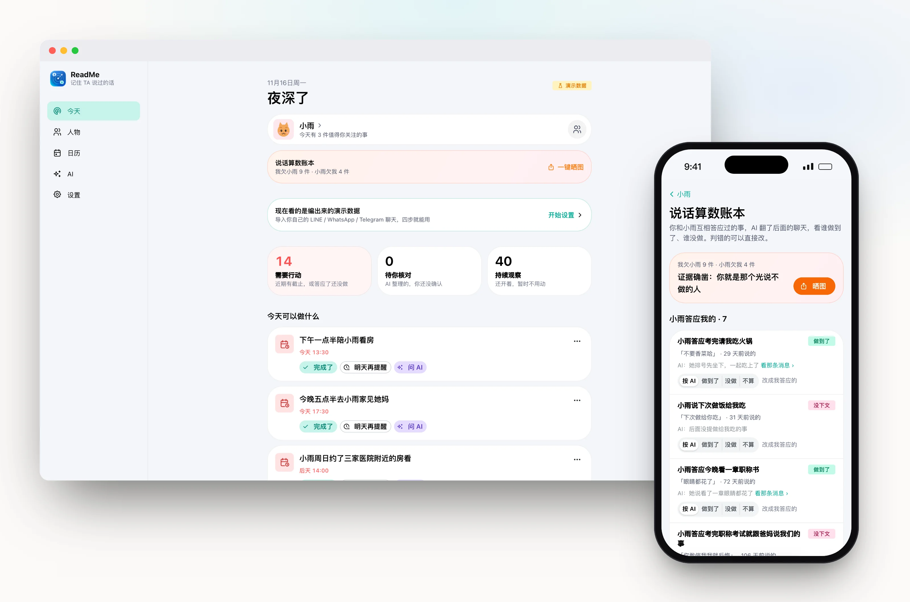
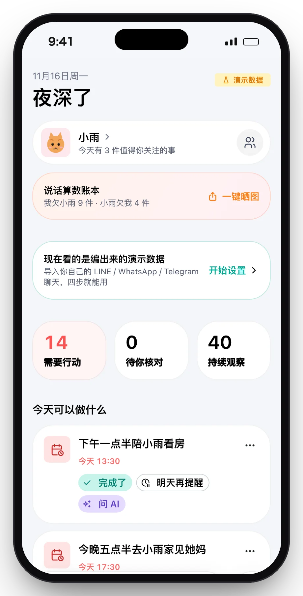
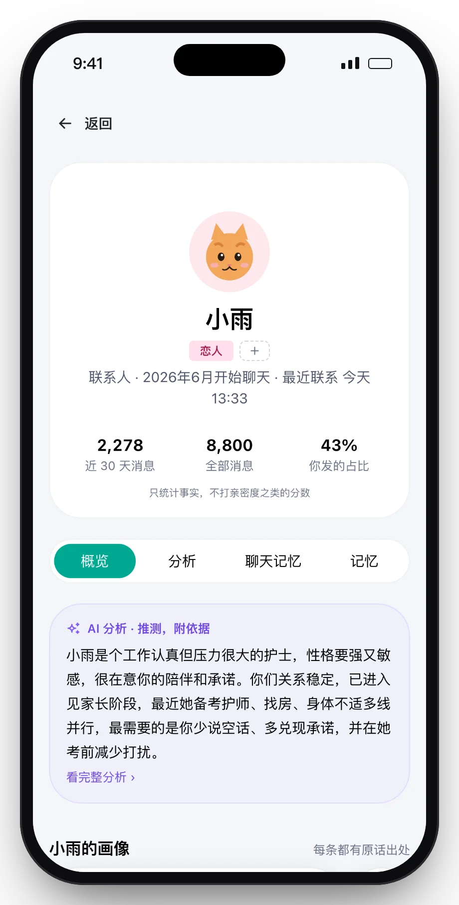
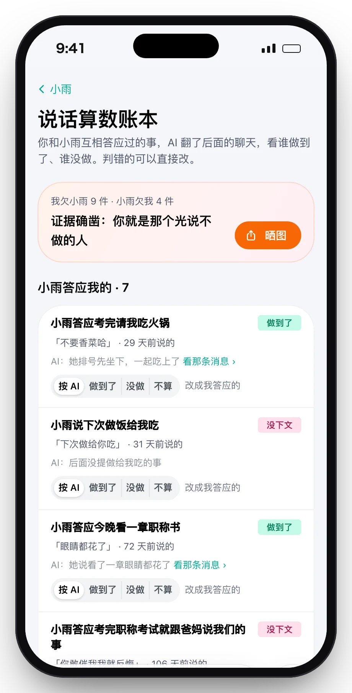
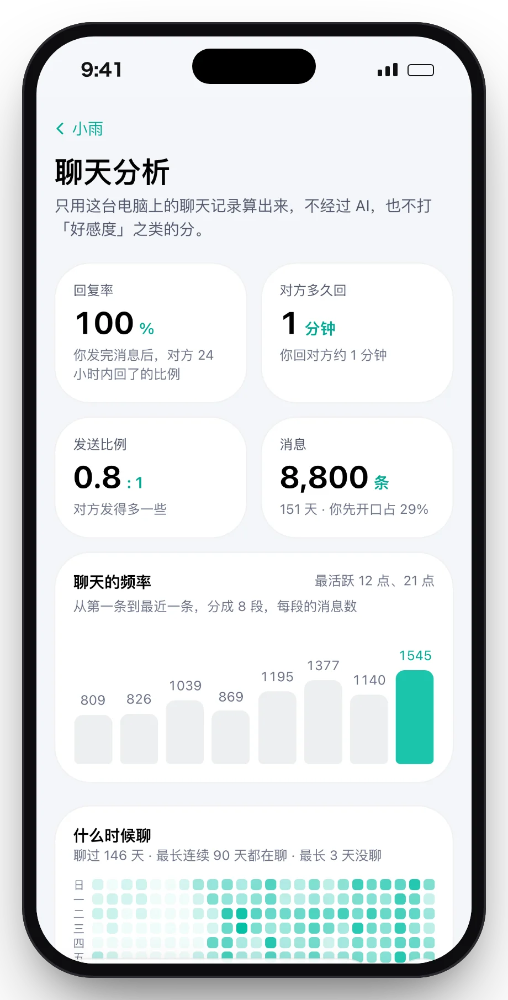
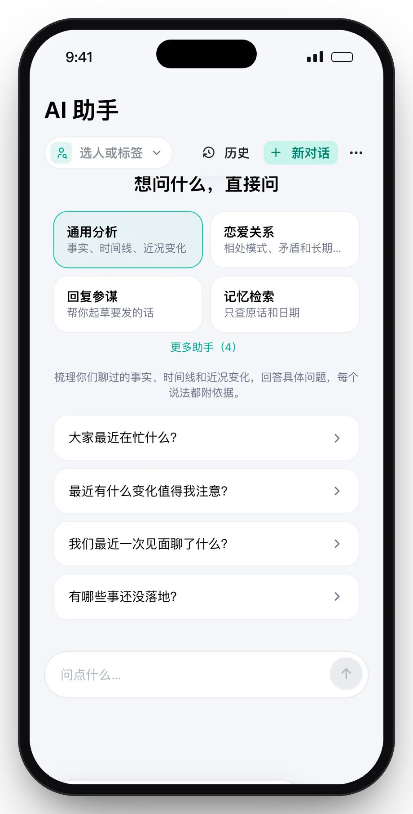
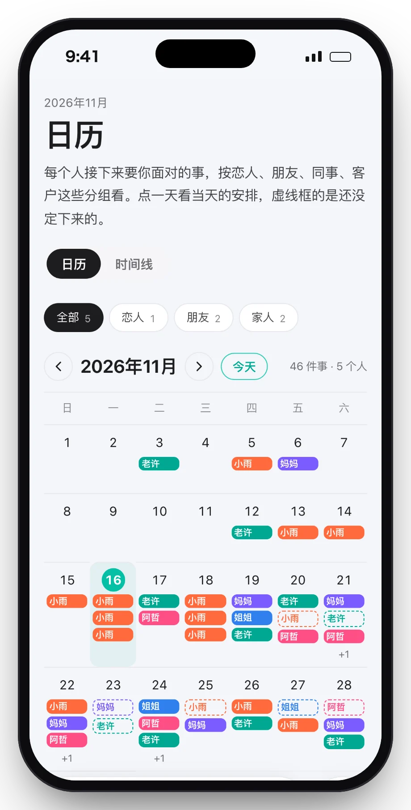

<picture>
  <source media="(prefers-color-scheme: dark)" srcset="docs/assets/banner-zh-dark.webp">
  
</picture>

<p align="center">
  本地运行的「身边人记忆」。<br>
  ReadMe 从聊天里找出约好的事、答应过的事和 TA 的喜好，到日子提醒你，<br>
  每一条都能点回当时的原话。
</p>

<p align="center">
  <a href="https://github.com/Ikarishinji00/personal-radar/releases/latest"></a>
  <a href="https://github.com/Ikarishinji00/personal-radar/actions/workflows/ci.yml"></a>
  
  <a href="LICENSE"></a>
  <a href="https://github.com/Ikarishinji00/personal-radar/stargazers"></a>
</p>

<p align="center">
  <a href="README.md">English</a> ·
  <b>简体中文</b> ·
  <a href="README.ja.md">日本語</a> ·
  <a href="https://ikarishinji00.github.io/personal-radar/?lang=zh">官网</a> ·
  <a href="#download">下载</a> ·
  <a href="docs/troubleshooting.md">常见问题</a>
</p>

<p align="center">
  <picture>
    <source media="(prefers-color-scheme: dark)" srcset="docs/assets/hero-zh-dark.webp">
    
  </picture>
</p>

她说下个月 18 号考试，让你考前少找她玩。你答应周末帮她修电脑。她提醒你明天见她爸妈别空手去，她爸爱喝茶。这些话都在聊天里，过两天就被新消息冲没了。

ReadMe 读你的聊天记录，把要紧的事挑出来：约好的日子、答应过的事、改了的安排、每个人喜欢什么、忌讳什么。它把这些放到对应的那一天，任何一条都能点开看当时的原话。全部在你自己的电脑上运行。

## 能做什么

<table>
  <tr>
    <td width="33%" align="center"><br><b>今天要做的事</b><br><sub>约好的时间、答应过的事，到日子出现在第一页。安排改了，旧的自动作废。</sub></td>
    <td width="33%" align="center"><br><b>每个人的画像</b><br><sub>喜好、忌讳、家人、近况，每一条都附着当时的原话。</sub></td>
    <td width="33%" align="center"><br><b>说话算数账本</b><br><sub>翻出你们互相答应过的事，谁做到、谁没做，一键生成能晒的卡片。</sub></td>
  </tr>
  <tr>
    <td width="33%" align="center"><br><b>聊天分析</b><br><sub>谁回得快、谁先开口、口头禅、什么时候聊得最多。本机计算，不用 AI。</sub></td>
    <td width="33%" align="center"><br><b>问 AI</b><br><sub>「她换工作的事是怎么说的？」只根据你的聊天回答，并标出处。</sub></td>
    <td width="33%" align="center"><br><b>日历</b><br><sub>按恋人、朋友、同事分组，一个月里谁有什么日子，一眼看全。</sub></td>
  </tr>
</table>

ReadMe 不替你做决定。AI 整理出来的内容在你确认之前都标着「待核对」，它也不会替你给任何人发消息。

导入自己的聊天之前，可以先逛三套虚构的演示：**生活**（恋人、朋友、家人）、**职场**（上司、同事、客户）、**夜场**（陪酒女和她的常客）。界面支持简体中文、繁體中文、日本語和 English。

<a id="download"></a>
## 下载

| | |
|---|---|
| **macOS**（Apple 芯片） | [ReadMe-mac-arm64.dmg](https://github.com/Ikarishinji00/personal-radar/releases/latest/download/ReadMe-mac-arm64.dmg) |
| **macOS**（Intel 芯片） | [ReadMe-mac-x64.dmg](https://github.com/Ikarishinji00/personal-radar/releases/latest/download/ReadMe-mac-x64.dmg) |
| **Windows** 10 / 11 | [ReadMe-windows-x64.zip](https://github.com/Ikarishinji00/personal-radar/releases/latest/download/ReadMe-windows-x64.zip) |
| **Linux**（x64） | [ReadMe-linux-x64.tar.gz](https://github.com/Ikarishinji00/personal-radar/releases/latest/download/ReadMe-linux-x64.tar.gz) |

下载后不用再装任何东西，安装包里自带运行环境。

- **Mac**：打开 `.dmg`，把 ReadMe 拖进「应用程序」。目前还没有经过苹果公证，第一次打开时要右键点 ReadMe →「打开」；macOS 15 及以上要去「系统设置 → 隐私与安全性」点「仍要打开」。之后 ReadMe 会待在屏幕顶部的菜单栏里，在浏览器中打开。
- **Windows**：解压后双击 `ReadMe.cmd`。如果弹出 SmartScreen，点「更多信息 → 仍要运行」。用 ReadMe 的时候别关那个小窗口。
- **Linux**：`tar xzf ReadMe-linux-x64.tar.gz && ./ReadMe/readme`

<details>
<summary>开发者：用 Node.js、Docker，或者让 AI 助手帮你装</summary>

```bash
npx github:Ikarishinji00/personal-radar      # 需要 Node.js 22.13 以上
```

- **Docker**：`docker compose up -d`，打开 http://localhost:3210，数据在 `./radar-data`。
- **源码**：`git clone`、`npm install`、`npm start`。
- **交给 AI 助手**：对 Claude Code、Codex 或 Cursor 说「读 AGENT_SETUP.md，在这台电脑上装好 ReadMe」，见 [AGENT_SETUP.md](AGENT_SETUP.md)。

</details>

打开后可以先看演示，也可以直接用自己的聊天。设置一共四步，不用改任何配置文件：导入、选 AI 服务、选要隐藏的信息、开始整理。

## 聊天从哪来

| 自动同步 | 从导出文件导入 |
|---|---|
| **iMessage**（Mac，只读） | **LINE** `.txt`（日文、中文、英文界面都行） |
| **WhatsApp** Mac 电脑版（只读，还没在真机上测过） | **WhatsApp** `.txt` / `.zip` |
| **Telegram** 官方接口 | **Telegram Desktop** `result.json` |
| **Beeper**（一个本机接口接多个软件，实验功能） | **Instagram / Messenger**、**Discord**、**Google Chat** |
| **微信**：你已经用其他工具解密到本机的文件夹 | **QQ** 导出、Markdown / 文本记录、通用聊天 JSON |
| 你让导出工具存进去的文件夹 | |

ReadMe 只读不写：不登录你的聊天账号，不通过它们发任何东西，也不带任何解密或抓取工具。各个 App 怎么导出，见 [导出指南](docs/export-guide.md)。

## 数据只属于你

- 聊天、整理结果、密钥都在你电脑上的 `~/.personal-radar` 里。没有账号，没有服务器。
- ReadMe 只在本机监听，同一个 Wi-Fi 里的人打不开。
- 只有两种时候会把内容发出去：整理聊天时，和你提问时。发出前都会按你的规则隐藏密钥、邮箱、手机号、卡号、证件号和链接，两处都能先预览要发什么。
- 可以让某个人完全不发给 AI。用 Ollama 跑本机模型，一条都不出门。
- AI 服务随你选：DeepSeek、OpenAI、Gemini、OpenRouter、Kimi、通义千问、智谱，或任何兼容 OpenAI 接口的服务；也可以不填密钥，交给你自己的 Claude Code、Codex 来整理。
- 「设置 → 数据管理」里可以把 ReadMe 写下的东西全部导出成 JSON，或者全部删除。

## 和别的工具比

| | ReadMe | [Monica](https://github.com/monicahq/monica) | [WeClone](https://github.com/xming521/WeClone) | [PingCRM](https://github.com/sneg55/pingcrm) |
|---|---|---|---|---|
| 主要做什么 | 从聊天里提醒约定、记住每个人 | 手动填写的个人 CRM | 人生画像和你的 AI 分身 | 从账号同步的人脉 CRM |
| 找出带日期的约定和承诺 | ✅ 附原话 | — | — | 跟进提醒 |
| 说话算数账本和分享卡片 | ✅ | — | — | — |
| 聊天来源 | 14 种，其中 5 种自动同步 | — | Telegram（加 CSV） | Gmail、Telegram、WhatsApp、X、LinkedIn |
| 桌面安装包 | ✅ macOS · Windows · Linux | 自建 | Python | 自建或云 |
| 运行在哪 | 你的电脑 | 自建或付费云 | 你的电脑 | 自建或云 |

## 常见问题

<details><summary><b>要钱吗？</b></summary>不要。ReadMe 开源（AGPL-3.0）。如果你用付费的 AI 服务，按用量直接付给那家服务；用本机模型不花钱。</details>
<details><summary><b>支持微信吗？</b></summary>微信官方不支持导出聊天记录。如果你已经用其他工具把微信数据库解密到本机，在「设置 → 聊天来源」选那个文件夹，ReadMe 会只读地持续同步。ReadMe 本身不做任何解密。</details>
<details><summary><b>能在手机上用吗？</b></summary>能。把电脑和手机放进你自己的私有网络（比如 Tailscale），再把页面加到主屏幕。提醒也可以用推送通知或 iPhone 上的 Bark 直接发到手机。</details>
<details><summary><b>它会替我给别人发消息吗？</b></summary>不会。ReadMe 没有发消息的能力，只负责读、整理和提醒。</details>
<details><summary><b>AI 整理错了怎么办？</b></summary>每一条都连着它出自的那几条消息。新整理出来的标着「待核对」，等你确认；任何一条都能改或删。</details>

## 路线图

- [x] macOS、Windows、Linux 桌面安装包
- [x] iMessage、WhatsApp（Mac）、Telegram、Beeper、微信文件夹自动同步
- [x] 说话算数账本和分享卡片
- [x] English、简体中文、繁體中文、日本語
- [ ] 经过苹果公证的 Mac 版
- [ ] 只读的在线演示
- [ ] KakaoTalk、Signal 导入
- [ ] MCP 服务：让 Claude 等助手直接问「我答应过她什么？」
- [ ] 整理准确率评测

## 参与

最有用的贡献是新的导入格式（KakaoTalk、Signal…）和对真实导出变体的修正，每种格式在 `tests/` 里都有样例和测试。提交前请先看 [CONTRIBUTING.md](CONTRIBUTING.md) 和 [CLA](CLA.md)，不要在 issue 里贴真实的聊天记录。

## Star 趋势

<a href="https://star-history.com/#Ikarishinji00/personal-radar&Date">
  <picture>
    <source media="(prefers-color-scheme: dark)" srcset="https://api.star-history.com/svg?repos=Ikarishinji00/personal-radar&type=Date&theme=dark">
    
  </picture>
</a>

## 致谢

感谢 [ChatLab](https://github.com/ChatLab/ChatLab) 开放的聊天格式和本地接口。

## 许可

Copyright © 2026 Fu Haike。以 [GNU AGPL-3.0](LICENSE) 发布：可以使用、修改、分享；如果把改过的版本作为服务提供给别人，需要用同样的许可公开你的修改。
